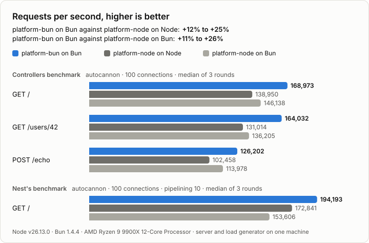

<div align="center">

# platform-bun

**An experimental, Bun-native HTTP adapter for [NestJS](https://nestjs.com)**

[](https://github.com/iiAku/platform-bun/actions/workflows/ci.yml)
[](#status)
[](./LICENSE)
[](https://bun.sh)
[](https://nestjs.com)
[](https://github.com/nestjs/nest/tree/59f33793c616eaf9669e8b81a35aa5f31accc5b4/packages/platform-node)

</div>

> [!WARNING]
> **Experimental and unofficial.** This project is not affiliated with or endorsed by NestJS. It is not published to npm, its API and behavior may change without notice, and it has not been run in production. Try it, measure it, and [report what breaks](https://github.com/iiAku/platform-bun/issues).

`@nestjs/platform-node` runs on Bun, but through Bun's `node:http` compatibility layer, which is written in JavaScript. platform-bun is a port of `@nestjs/platform-node@12.3.3` that serves Nest straight from `Bun.serve()`. Requests and responses are Node-shaped objects (the `IncomingMessage` and `ServerResponse` prototypes, streams, events, `req.socket`) built over the native `Request` and `Response`. Nest's router, the body parsers and Connect-style middleware run unchanged, with no Node HTTP parser in the path.

On the [benchmarks below](#performance), platform-bun on Bun serves 22–25% more requests per second than `platform-node` on Node 26 with real Nest controllers, and 12.4% more on Nest's own pipelined benchmark. Against `platform-node` running on Bun, its lead is 11–26%.

## Contents

- [Status](#status)
- [Features](#features)
- [Requirements](#requirements)
- [Installation](#installation)
- [Usage](#usage)
- [Performance](#performance)
- [Compatibility](#compatibility)
- [How it was built](#how-it-was-built)
- [Development](#development)
- [Contributing](#contributing)
- [License](#license)

## Status

- **Experimental.** Version 0.1.0, not published, with no stability promise. The API follows `@nestjs/platform-node` and may still change.
- **Tested, not proven.** The upstream suites, transport contract tests and differential tests against `@nestjs/platform-node` pass (1,594 tests). No production traffic has gone through it.
- **Single maintainer.** Issues and pull requests are welcome; answers are best effort.

## Features

- **Drop-in for `@nestjs/platform-node`.** It has the same options and API: routing, versioning, CORS, the body parsers (`useBodyParser('json' | 'urlencoded' | 'text' | 'raw', options)`), raw bodies, static assets, view engines and hooks. `MulterModule` and all five upload interceptors are included. The upstream names (`NodeAdapter`, `NodeRequest`, `NodeResponse`, `NodeRouter`, their types and deep imports) are exported as migration aliases.
- **Node semantics that middleware relies on.** These include `'finish'`/`'close'` order, write backpressure and `'drain'`, client aborts before and during a reply, the header API, `req.signal`, `close()` and `closeAllConnections()`, and Node's `keepAliveTimeout` and `keepAliveTimeoutBuffer`. It is tested with `compression`, `helmet`, `cookie-parser`, `express-session` and `express-rate-limit`.
- **Native fast paths.**
  - A one-body reply becomes a single native `Response`.
  - Streamed replies (`write()`, `pipe()`, SSE, `StreamableFile`) go through a pull-based body that passes the client's backpressure on to the producer.
  - The body parsers read a body of known length in one native call.
  - Request headers, `req.socket` and the client-abort watch are built only when read.
- **HTTPS** through a `tls.Server` facade, so `app.getUrl()` reports `https`.

## Requirements

- Bun 1.4.4 or later
- NestJS 12 (`@nestjs/common` and `@nestjs/core`)
- TypeScript with `experimentalDecorators` and `emitDecoratorMetadata`; run the app with `bun run main.ts`

## Installation

The package is not on npm, and `package.json` is marked `private` so it can't be published by accident. Build a tarball from this repository, then install it in your project:

```sh
git clone https://github.com/iiAku/platform-bun.git
cd platform-bun
bun install --frozen-lockfile
npm pack        # builds dist/ and writes nestjs-platform-bun-0.1.0.tgz

cd /path/to/your-app
bun add /absolute/path/to/platform-bun/nestjs-platform-bun-0.1.0.tgz
```

The package keeps the name `@nestjs/platform-bun`, mirroring `@nestjs/platform-node`, as a local identity only (see [NOTICE](./NOTICE)).

## Usage

```ts
import { NestFactory } from '@nestjs/core';
import { BunAdapter, type NestBunApplication } from '@nestjs/platform-bun';
import { AppModule } from './app.module.js';

const app = await NestFactory.create<NestBunApplication>(
  AppModule,
  new BunAdapter({ maxParamLength: 100, trustProxy: 'loopback' }),
  { rawBody: true },
);
await app.listen(3000, '127.0.0.1');
```

- `getType()` returns `'bun'`. A library that accepts only `'express'`, `'fastify'` or `'node'` needs Bun support, even when its middleware works as is.
- `getHttpServer()` returns a `BunHttpServer`. It is an `EventEmitter` with the `http.Server` lifecycle API: `listen`, `address`, `close`, `closeAllConnections`, `ref`/`unref`, `keepAliveTimeout` and `keepAliveTimeoutBuffer`. Its `.nativeServer` is the `Bun.serve()` instance.
- `closeAllConnections()` rotates the native listener on the same address, because Bun can't close active sockets while keeping its listener. Code holding `.nativeServer` should read it again afterwards.
- `BunRequest` and `BunResponse` expose the upstream Express-style helpers and the Node stream API that middleware uses.
- Parser limits, verification, raw bodies, charsets and prototype-poisoning checks remain the upstream parsers' responsibility.

## Performance

In each benchmark, the three targets serve the same Nest application:

- **platform-bun on Bun**: this adapter.
- **platform-node on Node**: the published `@nestjs/platform-node`, the adapter this one ports, on Node 26.
- **platform-node on Bun**: the same published adapter running on Bun, through Bun's `node:http` compatibility layer.

<picture>
  <source media="(prefers-color-scheme: dark)" srcset="benchmark/results/chart-dark.svg">
  
</picture>

How many more requests per second platform-bun on Bun served:

| Against | GET `/` | GET `/users/42` | POST `/echo` | Nest's benchmark |
| --- | ---: | ---: | ---: | ---: |
| platform-node on Node | +21.6% | +25.2% | +23.2% | +12.4% |
| platform-node on Bun | +15.6% | +20.4% | +10.7% | +26.4% |

- **The controllers benchmark** runs real Nest controllers, the same on every adapter: a plaintext GET, a JSON reply with a route parameter, and a JSON POST, the workload of [Nest PR #18063](https://github.com/nestjs/nest/pull/18063). Each of 100 connections sends one request at a time.
- **Nest's benchmark** is Nest's own `tools/benchmarks`: GET `/` answers "Hello world!" to 100 connections that pipeline 10 requests each.
- **Conditions.** Each figure is the median of three rounds, the target order rotating between rounds: Node 26.13.0, Bun 1.4.4, Nest 12.3.3 and autocannon 8.0.0 on an AMD Ryzen 9 9900X (12 cores, SMT off, `performance` profile), the server pinned to four CPUs and the load generator to the other eight.
- **Cross-checks.** Two other load generators rank the targets the same way. Under [oha](https://github.com/hatoo/oha), which does not pipeline, platform-bun leads `platform-node` on Node by 26–29% and on Bun by 12–17% on the controllers benchmark. Under [wrk](https://github.com/wg/wrk), on Nest's benchmark, it leads them by 11.6% and 20.2%.
- **Other adapters.** The Express and Fastify adapters, on Bun and on Node, are in the reports: platform-bun served more requests per second than every other Nest adapter measured.
- **Ceiling.** A bare `Bun.serve()` handler, with no Nest at all, serves 202,790 requests per second on the controllers' GET `/` and 281,030 on Nest's benchmark.

These are loopback microbenchmarks on one machine. They rank the adapters on these workloads; they do not predict a production application's throughput. Each run has its report and raw data: the controllers benchmark under [autocannon](./benchmark/results/controllers-autocannon/report.md) and [oha](./benchmark/results/controllers-oha/report.md), and Nest's under [autocannon](./benchmark/results/nest-autocannon/report.md) and [wrk](./benchmark/results/nest-wrk/report.md). [VALIDATION.md](./VALIDATION.md#benchmark) explains how each figure was checked, with the servers' CPU and kernel time, and [benchmark/README.md](./benchmark/README.md) how to reproduce them.

## Compatibility

The upstream test suites run against this adapter. So do transport contract tests, and differential tests that compare it with `@nestjs/platform-node` running on Node. Where `Bun.serve()` forces a different behavior, the difference is asserted in a test and documented in [COMPATIBILITY.md](./COMPATIBILITY.md). These are the ones most likely to matter:

- **Pipelining.** Bun closes the connection when a request is pipelined behind a response that is still pending across an I/O turn ([oven-sh/bun#38128](https://github.com/oven-sh/bun/issues/38128)).
- **Idle connections.** Idle keep-alive connections close 8–12 s after the last reply, where Node closes them after 6 s, because Bun's idle timer ticks every 4 s. A connection that sends no request closes after the same window, where Node waits up to 60 s.
- **Sockets.** `req.socket` is request-scoped metadata, not raw TCP access, so protocol upgrades are not supported.
- **Headers and informational responses.** `100 Continue`, `102 Processing`, early hints and trailers are not sent. Header names go out lower-cased, and `rawHeaders` loses the original casing and order.

## How it was built

<details>
<summary>The port, the rewrite on <code>Bun.serve()</code>, and how each step was measured</summary>

<br>

The package is `@nestjs/platform-node` ported to native Bun in several iterations. Each one was measured against the published Node adapter running on the same Bun.

1. **The port.** Codex ported `@nestjs/platform-node@12.3.2` (router, body parsers, request/response helpers, Multer module, upstream test suites) with two Bun transports: `Bun.listen` fed into Bun's `node:http` parser (the default), and a first `Bun.serve()` bridge. Both were slower than the published adapter on Bun: 32–39% and 19–24% on the three benchmark routes.
2. **One transport.** The socket transport and the `transport` option were removed. `Bun.serve()` is the only transport, and instead of asking Bun to emulate `node:http`, the adapter builds its own Node-shaped objects over the native `Request`/`Response`: a request that is a `Readable` on the `IncomingMessage` prototype chain, with headers, `complete`, the socket facade and the abort watch built on first use; a response with the `OutgoingMessage` API whose `end()` becomes one native `Response`; `BunHttpServer` with the `http.Server` lifecycle (`close()` frees the port at once when idle, `closeAllConnections()` rotates the listener, 503 on closing), and a `tls.Server` facade for HTTPS.
3. **Streams.** Streamed replies first used a Bun "direct" stream, whose `write()` never reports backpressure: a client that stopped reading made the server buffer the whole body (an unbounded-stream test drove a test worker to 43 GB). They now go through a pull-based `ReadableStream` whose `pull()` drives `'drain'`, so `write()` returns `false` at a 16 KiB high-water mark and the producer follows the client.
4. **The request body.** CPU profiles of the POST route guided the parser's native path: the `Request.body` getter alone cost 17% of the request, so `complete` became lazy; the body is then read in one native call (callback style, the Node stream ended in place), the parser reads its headers through native `Headers.get` without building `req.headers`, and UTF-8 JSON, form and text bodies are decoded natively as text. The POST route went from 94k to 120k requests/s across these steps, with the stream path kept whenever a listener or reader is already consuming the body.
5. **Contracts and reviews.** The upstream suites run on `bun test` together with the transport's own: 1,594 tests in 69 files. Their only edits replace `vi.waitFor` with a local helper, rename unused parameters for the linter, give the ejs "view options" test a stand-in engine (ejs 7 no longer reads that setting), and change the expectations where `Bun.serve()` answers differently (an asterisk-form target gets a 400, a 204 carries no Content-Length), each listed in COMPATIBILITY.md. 71 transport tests pin the Node contracts middleware relies on (finish/close order, backpressure, aborts before and mid-reply, the header API, `req.signal`, `close()`, idle keep-alive connections); differential tests compare the adapter with the published one in a Node process, and middleware tests run `compression`, `helmet`, `cookie-parser`, `express-session` and `express-rate-limit` on both. Codex reviewed the design before the rewrite and the diff blind afterwards: four findings (among them `'finish'` firing before Bun had taken a chunked body, and a fabricated byte count on aborts) were fixed and covered by tests. An adversarial multi-agent review (37 agents over five dimensions, each finding reproduced by a probe and challenged by a refuter) then confirmed 12 distinct defects and left 3 unverified at its cap. 13 of the 15 were fixed with tests, among them a client that left before anything listened going unnoticed (the response leaked and `close()` never completed) and `close()` doing nothing after a second `listen()`; the other two are limits of `Bun.serve()`, documented in COMPATIBILITY.md.
6. **The response path.** CPU profiles of Nest's own benchmark (GET `/`, pipelining 10) drove the last iteration. A reply's `ResponseInit` is a shared object carrying only what differs from Bun's defaults; a reply whose only header is its Content-Type shares a cached native `Headers`, which `Response()` copies for much less than it converts an object of headers; the Content-Length that Bun computes itself is left out; the event state of requests and responses is created with their first listener; the responses in flight are an indexed array rather than a `Set`; and a request's handler runs the microtasks it queued (`drainMicrotasks()` from `bun:jsc`), so that a Nest handler that awaited nothing pending hands Bun a `Response` rather than a promise. Measured in process (the fetch handler called with native `Request`s in batches of 10, without sockets, medians of five interleaved runs on one pinned core), a Nest request went from 1,516 to 934 ns, and the transport alone from 735 to 382 ns. Codex reviewed this iteration's diff blind in two rounds and confirmed no finding; a mutation check of its decisions left only four mutants that change no observable behavior, listed in VALIDATION.md.
7. **Toolchain.** Vitest, Prettier and `tsc --noEmit` gave way to Bun's own tools, and a linter was added: `bun test` ran the adapter's suite in 14 s at a 164 MB memory peak, where vitest needed 18 s and 345 MB for fewer tests (the benchmark runners' tests, which start real benchmark runs, now add 25 s, and the keep-alive tests, which wait on Bun's idle timer, 8.5 s), `bun check` type-checks in under a second, and `bun check`, `bun lint` (a pinned canary) and `bun fmt` run from lefthook before each commit. `tsc` is left only to build `dist/`, because neither `bun check` nor `bun build` emits the `.d.ts` declarations the package ships.
8. **Idle connections.** The port disabled Bun's idle timeout so that SSE replies stayed open, which left idle keep-alive connections open forever. Bun's timer also cuts a request in flight, so the adapter now sets it from Node's `keepAliveTimeout` and `keepAliveTimeoutBuffer`, rounded up to Bun's four-second ticks so that a connection is never closed before the configured time, holds it off for a reply produced across turns or streamed, and arms it again as that reply completes, while Bun still has the request. A reply produced during its dispatch, the benchmarks' path, makes no extra native call.
9. **Nest 12.3.3.** Nest 12.3.3, released on 2026-11-04, changed `platform-node` in four places, ported here with their tests: `use()` takes a list of mount paths, as Express does; `req.res` is set before the middleware runs; Nest's replies and `render()` go through a `res.send()` or `res.json()` that a middleware wrapped; and a view is also looked up as `<name>/index.<ext>`. The dependencies and tools moved to their latest releases with it (TypeScript 7, ejs 7, the latest Bun canary for `bun lint`), and every benchmark ran again.
10. **Result.** With Node 26.13.0 and Bun 1.4.4, SMT off and the same pinned CPUs for every target, the controllers benchmark puts the adapter 22–25% ahead of `platform-node` on Node and 11–20% ahead of it on Bun across its three routes. On Nest's own pipelined benchmark the adapter is 12.4% ahead of `platform-node` on Node and 26.4% ahead of it on Bun. Every server there is saturated, and the kernel's delivery of each response, one TCP segment per pipelined reply on both runtimes, takes 36% of `platform-node`'s time on Node and 43% of the adapter's, time in which the adapter saves nothing. The lead over `platform-node` on the same runtime is the adapter's own. Moving `platform-node` itself to Bun gains 4–11% in the first benchmark and loses 11.1% in Nest's, where the cost of `node:http` on Bun, a compatibility layer written in JavaScript, shows.

</details>

## Development

```sh
bun install --frozen-lockfile   # also installs the git hooks (lefthook)
bun run build                   # compile src/ to dist/ with tsc (the JavaScript and the .d.ts declarations)
bun run check                   # type-check with bun check
bun run lint                    # lint (a pinned Bun canary: bun lint ships only in canaries)
bun run fmt --check             # check formatting
bun run test                    # the whole suite; needs Node 26 on PATH for the differential tests
```

The benchmarks run with `bun run bench` and `bun run bench:nest` (see [benchmark/README.md](./benchmark/README.md)). Tests, mutation checks, reviews and benchmark evidence are collected in [VALIDATION.md](./VALIDATION.md).

## Contributing

Contributions are welcome: start with [CONTRIBUTING.md](./CONTRIBUTING.md). Please follow the [code of conduct](./CODE_OF_CONDUCT.md), and report security issues privately as described in [SECURITY.md](./SECURITY.md).

## License

[MIT](./LICENSE). This project is derived from [NestJS](https://github.com/nestjs/nest) (MIT, © Kamil Mysliwiec). The router, body parsers, request and response helpers, views, Multer support and the upstream tests are adapted from `@nestjs/platform-node@12.3.3` at commit [`59f33793`](https://github.com/nestjs/nest/tree/59f33793c616eaf9669e8b81a35aa5f31accc5b4), following the design of [nestjs/nest#18063](https://github.com/nestjs/nest/pull/18063). [NOTICE](./NOTICE) has the details.
